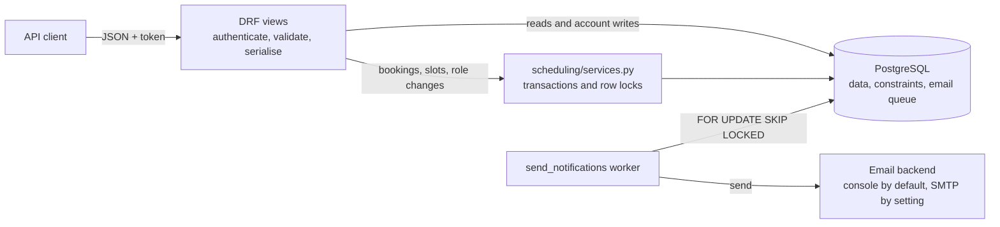
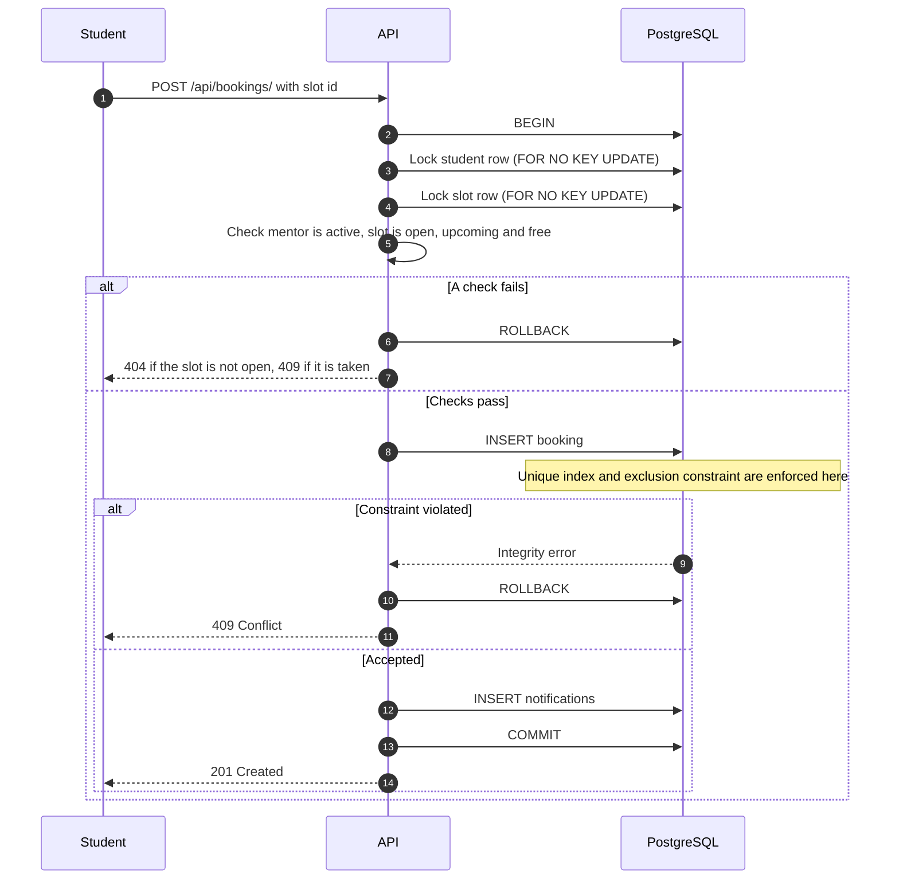

<p align="center">
  
</p>

<h1 align="center">InterviewOps</h1>

<p align="center"><strong>Mock interviews, booked without collisions.</strong></p>

<p align="center">
  A Django REST API for scheduling mock interviews, built around ordered transactions,<br>
  PostgreSQL constraints, and a durable database-backed email queue.
</p>

<p align="center">
  <a href="https://github.com/InsaneCoder789/InterviewOps/actions/workflows/test.yml"></a>
  
  
  
  <a href="LICENSE"></a>
</p>

<p align="center">
  <a href="#quickstart">Get started</a> ·
  <a href="#booking-flow">How it works</a> ·
  <a href="docs/API.md">API reference</a> ·
  <a href="docs/ARCHITECTURE.md">Architecture</a> ·
  <a href="#known-limits">Known limits</a>
</p>

> **Project status:** The backend runs locally, directly or with Docker Compose.
> It has not been deployed and there is no hosted instance. See
> [deployment status](#deployment-status).

## The problem

Booking a time slot looks like "check that it is free, then insert a row". Two
requests can pass that check at the same moment, and both insert.

InterviewOps is a small backend built around that problem. A service layer takes
row locks in a fixed order and returns a clear `409 Conflict`. PostgreSQL
separately enforces a partial unique index and exclusion constraints, so code
that skips the service still cannot book one slot twice. The student-overlap
rule compares times the service copies from the slot, so it relies on those
being correct.

## What it does

- **Invite-only community:** an admin invites students and mentors by email;
  public sign-up is closed outside local development.
- **Accounts:** profiles, a mentor directory, password change and reset, expiring
  tokens, and deactivation that cancels future sessions.
- **Collision-free scheduling:** one active booking per slot, no overlapping
  slots for a mentor, no overlapping bookings for a student, including when
  rescheduling.
- **Sessions:** a meeting link from the mentor, preparation notes from the
  student, and attendance.
- **Feedback:** ratings, strengths, improvements and next steps, with progress
  over time.
- **Email:** confirmations, reminders, changes and cancellations through a queue
  stored in PostgreSQL, with retries. No message broker.
- **Admin tools:** an overview, delivery records and retry for failed mail.
- **Operations:** CI, a local Compose stack, backup and restore scripts, health
  and queue checks.

## Architecture



The web process and the mail worker share only the database. More detail is
in [docs/ARCHITECTURE.md](docs/ARCHITECTURE.md).

## Booking flow



A slot that is missing, cancelled, started or whose mentor is inactive returns
`404`. A caller who is not an active student gets `403`.

## Quickstart

You need Python and a running PostgreSQL. The project is tested with Python 3.14
and PostgreSQL 18.

```bash
git clone https://github.com/InsaneCoder789/InterviewOps.git
cd InterviewOps
python3 -m venv .venv && source .venv/bin/activate
pip install -r requirements.txt
createdb interviewops
export DJANGO_DEBUG=1 DATABASE_URL=postgresql://$(whoami)@localhost:5432/interviewops
python manage.py migrate
python manage.py createsuperuser
python manage.py runserver
```

Start the mail worker in a second terminal, from the same directory:

```bash
source .venv/bin/activate
export DJANGO_DEBUG=1 DATABASE_URL=postgresql://$(whoami)@localhost:5432/interviewops
python manage.py send_notifications
```

- A user made with `createsuperuser` gets the admin role.
- `send_notifications --once` processes due email and exits.
- `python manage.py seed_demo` adds made-up users and sessions.
- With Docker, run `sh scripts/local_env.sh` once, then
  `docker compose up --build`.
- A migration creates the `btree_gist` extension, so the database user needs
  permission to create it.
- Django does not read `.env` files here. [`.env.example`](.env.example) lists
  variables to export in your shell.
- In debug mode, emails are printed to the worker's output by default.
- The Django admin is at `/admin/` in debug mode.

## Walkthrough

With the server running on a fresh database, this publishes a slot, books it,
shows a conflict and cancels. It uses `curl` and `python3`, and each run
generates its own password. Run it in `bash` (type `bash` first if your shell
is zsh), in a third terminal with the virtualenv active and the same two
variables exported.

```bash
BASE=http://127.0.0.1:8000
json() { python3 -c "import sys, json; print(json.load(sys.stdin)['$1'])"; }
post() { curl -sS -H 'Content-Type: application/json' "$@"; }

# 1. Create an admin for this walkthrough
DEMO_PASS="$(python3 -c 'import secrets; print(secrets.token_urlsafe(16))')"
DJANGO_SUPERUSER_PASSWORD="$DEMO_PASS" python manage.py createsuperuser \
  --noinput --username demo-admin --email demo-admin@example.test

# 2. Register three users; all start as students
register() {
  post "$BASE/api/auth/register/" \
    -d "{\"username\":\"$1\",\"email\":\"$1@example.test\",\"password\":\"$DEMO_PASS\"}"
}
MAYA_ID=$(register maya | json id)
register ravi; echo
register sam; echo

# 3. Log in
login() { post "$BASE/api/auth/login/" -d "{\"username\":\"$1\",\"password\":\"$DEMO_PASS\"}" | json token; }
ADMIN=$(login demo-admin)
MAYA=$(login maya)
RAVI=$(login ravi)
SAM=$(login sam)

# 4. The admin makes maya a mentor
post -X PATCH "$BASE/api/users/$MAYA_ID/role/" \
  -H "Authorization: Token $ADMIN" -d '{"role":"mentor"}'; echo

# 5. maya publishes a one-hour slot two days from now
when() { python3 -c "from datetime import *; print((datetime.now(timezone.utc) + timedelta(hours=$1)).strftime('%Y-%m-%dT%H:%M:00Z'))"; }
SLOT_ID=$(post "$BASE/api/slots/" -H "Authorization: Token $MAYA" \
  -d "{\"topic\":\"System design\",\"starts_at\":\"$(when 48)\",\"ends_at\":\"$(when 49)\"}" | json id)

# 6. ravi finds it and books it: 201
curl -sS "$BASE/api/slots/?available=true&topic=design" -H "Authorization: Token $RAVI"; echo
BOOKING_ID=$(post "$BASE/api/bookings/" -H "Authorization: Token $RAVI" \
  -d "{\"slot\":$SLOT_ID}" | json id)

# 7. sam tries the same slot: 409 {"detail":"This slot is already booked."}
post -i "$BASE/api/bookings/" -H "Authorization: Token $SAM" -d "{\"slot\":$SLOT_ID}"; echo

# 8. ravi cancels, and sam can now book
post -X POST "$BASE/api/bookings/$BOOKING_ID/cancel/" -H "Authorization: Token $RAVI"; echo
post -i "$BASE/api/bookings/" -H "Authorization: Token $SAM" -d "{\"slot\":$SLOT_ID}"; echo
```

Sign-up and login share a limit of 10 requests per minute per client address, so
running the walkthrough twice in a row can return `429`.

## API

Send `Authorization: Token <token>`. Times are ISO 8601; the server stores UTC.
[docs/API.md](docs/API.md) is the full reference.

| Area | Endpoints under `/api/` |
|---|---|
| Sign-in | `auth/register`, `auth/login`, `auth/logout`, `auth/me`, `auth/accept-invitation`, `auth/password`, `auth/password-reset` |
| People | `invitations`, `users`, `users/{id}/role`, `users/{id}/status`, `profile`, `users/{id}/profile`, `mentors` |
| Sessions | `slots`, `bookings`, and per booking `cancel`, `reschedule`, `attendance` |
| Feedback | `bookings/{id}/feedback`, `feedback`, `feedback/progress` |
| Admin | `admin/overview`, `notifications` |
| Client settings | `config` |

`GET /health/` checks the database.

## Rules

- A slot lasts 15 minutes to 3 hours, starts in the future and cannot be edited.
- A mentor's active slots cannot overlap. Back-to-back is fine.
- A slot has at most one active booking, and a student's bookings cannot overlap.
- Students must cancel at least 2 hours ahead. Mentors and admins can cancel
  until the session starts.
- Cancelling a booking reopens the slot. Cancelling a slot cancels its booking.
- A slot can be cancelled only before it starts.
- A role cannot change while the user has slots or bookings that have not ended,
  and admins cannot change their own role. Leaving the admin role also removes
  Django admin access.
- Students see upcoming, uncancelled slots of active mentors, booked or not.
  Mentors see their own slots. Admins see all.

## Design decisions

**Two layers against double-booking.** `scheduling/services.py` locks the
student row, then the slot row, then checks the rules. Independently,
PostgreSQL enforces a partial unique index and exclusion constraints.

**Half-open time ranges.** Sessions are compared as `[start, end)`, so one that
ends at 10:00 does not collide with one that starts at 10:00.

**A fixed lock order** (user, slot, booking). See
[the deadlock investigation](docs/investigation-001-deadlock.md).

**Database queue instead of a broker.** Email rows are written in the same
transaction as the change, so neither can happen alone. Workers claim rows
with `FOR UPDATE SKIP LOCKED`, take a 5-minute lease, send outside the
transaction and retry with exponential backoff: the wait doubles from 60 s up to
a cap of one hour, for 10 attempts in total. At higher volume, or with many task
types, Celery with a broker would be worth the extra service.

**Hidden, not forbidden.** Another user's booking returns `404`, the same answer
as a booking that does not exist.

## Testing

With PostgreSQL running and the variables from the quickstart exported:

```bash
python manage.py test tests
```

The database user needs permission to create the test database.

| Kind | What it checks |
|---|---|
| Behaviour | every rule, refusal and email |
| Access policy | every route called by every kind of caller |
| Hostile input | seeded random and malformed requests never cause a server error |
| Concurrency | real threads on real PostgreSQL, including a randomized stress test that checks invariants |
| Processes | the worker against a local mail server, including being killed mid-send |
| Upgrades | the email uniqueness migration |

For lint, formatting, coverage and the dependency audit, see
[CONTRIBUTING.md](CONTRIBUTING.md#check-your-change). A passing run of timing
tests is not proof that no race exists.

The [test workflow](.github/workflows/test.yml) also checks migrations and
production settings, restores a backup and builds the container. See
[docs/OPERATIONS.md](docs/OPERATIONS.md).

## Deployment status

The container image builds and the Compose stack has been run locally.
**Nothing has been deployed**, and `render.yaml` has not been applied. If you try
it:

- Check current Render plans and pricing first. The blueprint's background worker
  uses a paid service type.
- On a custom domain, set `DJANGO_ALLOWED_HOSTS`.
- Set `APP_BASE_URL` and `CORS_ALLOWED_ORIGINS` for the web app.
- Configure an email backend and its SMTP variables on the worker. With debug
  off, the worker refuses to start with the console backend.
- The Django admin is off when debug is off. `ENABLE_ADMIN=1` turns it on.
- Create the first admin with `python manage.py createsuperuser` against the
  production database.

Configuration variables are listed in
[docs/ARCHITECTURE.md](docs/ARCHITECTURE.md#configuration).

The application writes one log line per request with a request ID (also returned
in `X-Request-ID`), without bodies, query strings or tokens. Django adds its own
warning or error line, including the path, for failed requests, and the
development server (`runserver`) logs the full request line, query string
included.

## Known limits

- No web app yet; this repository is the backend.
- Email is at-least-once: a worker crash after sending can cause a repeat, and a
  cancellation during a send cannot recall it.
- A message is marked failed after 10 unsuccessful attempts, roughly four hours
  of mail outage; an admin can retry it.
- Email is plain text, with times in UTC.
- Each user has one token, shared by all their clients.
- The sign-in rate limit is not atomic.
- No slot editing, recurring availability, calendar sync, video calls or
  payments.
- Cancelled, started and role rules are enforced by the application, not the
  database.
- The Django admin login page has no rate limit if the admin is enabled.

[docs/PRODUCT.md](docs/PRODUCT.md) lists what comes next.

## Repository layout

```text
accounts/            users, invitations, profiles, authentication
scheduling/          slots, bookings, sessions, services
notifications/       email queue, worker, delivery records, admin overview
feedback/            session feedback and progress
config/              settings, URLs, health check, request logging, pagination
tests/               API, email and concurrency tests
scripts/             backup and restore
docs/                architecture, API reference, investigation notes, brand
.github/             test and deploy workflows, templates
Dockerfile           container image
render.yaml          Render blueprint (not yet deployed)
```

## Contributing and security

See [CONTRIBUTING.md](CONTRIBUTING.md). Report vulnerabilities privately, as
described in [SECURITY.md](SECURITY.md).

## Licence

[MIT](LICENSE) © 2026 Rohan Chatterjee
