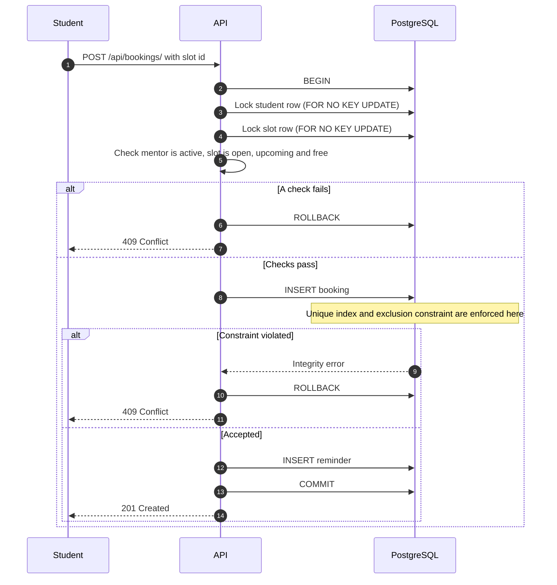

<h1 align="center">
  
</h1>

<p align="center"><strong>Mock interviews, booked without collisions.</strong></p>

<p align="center">
  A Django backend for scheduling mock interviews, where the database itself rejects double-booking.
</p>

<p align="center">
  <a href="https://github.com/InsaneCoder789/InterviewOps/actions/workflows/test.yml"></a>
  
  
  
  <a href="LICENSE"></a>
</p>

<p align="center">
  <a href="#quickstart">Quickstart</a> ·
  <a href="#walkthrough">Walkthrough</a> ·
  <a href="docs/API.md">API reference</a> ·
  <a href="docs/ARCHITECTURE.md">Architecture</a> ·
  <a href="#known-limits">Known limits</a>
</p>

> **Status:** runs locally. The container image and the Render blueprint have not
> been built or deployed, and there is no hosted instance.

## Why it exists

Booking a time slot looks like "check that it is free, then insert a row". Two
requests can pass that check at the same moment, and both insert.

InterviewOps is a small backend built around that problem. A service layer takes
row locks in a fixed order and returns a clear `409 Conflict`. PostgreSQL
separately enforces a partial unique index and exclusion constraints, so code
that skips the service still cannot create a double booking.

## Features

- **Three roles:** students book, mentors publish slots, admins manage both and
  change roles. Public sign-up always creates a student.
- **Collision-free scheduling:** one active booking per slot, no overlapping
  slots for a mentor, no overlapping bookings for a student.
- **Cancellation rules:** a two-hour cutoff for students, and a cancelled
  booking reopens its slot.
- **Deactivated accounts:** an inactive mentor's slots cannot be booked, and
  reminders involving an inactive user are skipped.
- **Email reminders:** a queue stored in PostgreSQL, with leases, retries and
  exponential backoff. No message broker.
- **REST API:** token authentication, pagination, filtering and throttled
  sign-up and login.
- **Operations basics:** a database health check and an application log line per
  request with a request ID.

## Architecture


The web process and the reminder worker share only the database. More detail is
in [docs/ARCHITECTURE.md](docs/ARCHITECTURE.md).

## Booking flow



A missing slot returns `404`, and a caller who is not a student gets `403`.

## Quickstart

You need Python and a running PostgreSQL. The project is tested with Python 3.14
and PostgreSQL 18.

```bash
git clone https://github.com/InsaneCoder789/InterviewOps.git
cd InterviewOps
python3 -m venv .venv && source .venv/bin/activate
pip install -r requirements.txt
createdb interviewops
export DJANGO_DEBUG=1 DATABASE_URL=postgresql://$(whoami)@localhost:5432/interviewops
python manage.py migrate
python manage.py createsuperuser
python manage.py runserver
```

Start the reminder worker in a second terminal, from the same directory:

```bash
source .venv/bin/activate
export DJANGO_DEBUG=1 DATABASE_URL=postgresql://$(whoami)@localhost:5432/interviewops
python manage.py send_reminders
```

- A user made with `createsuperuser` gets the admin role.
- `send_reminders --once` processes due reminders and exits.
- A migration creates the `btree_gist` extension, so the database user needs
  permission to create it.
- Django does not read `.env` files here. [`.env.example`](.env.example) lists
  variables to export in your shell.
- In debug mode, reminder emails are printed to the worker's output by default.
- The Django admin is at `/admin/` in debug mode.

## Walkthrough

With the server running on a fresh database, this publishes a slot, books it,
shows a conflict and cancels. It uses `curl` and `python3`, and the passwords are
throwaway values for local use. Run it in `bash` (type `bash` first if your shell
is zsh), in a third terminal with the virtualenv active and the same two
variables exported.

```bash
BASE=http://127.0.0.1:8000
json() { python3 -c "import sys, json; print(json.load(sys.stdin)['$1'])"; }
post() { curl -sS -H 'Content-Type: application/json' "$@"; }

# 1. Create an admin for this walkthrough
DJANGO_SUPERUSER_PASSWORD='local-demo-admin-pass' python manage.py createsuperuser \
  --noinput --username demo-admin --email demo-admin@example.test

# 2. Register three users; all start as students
register() {
  post "$BASE/api/auth/register/" \
    -d "{\"username\":\"$1\",\"email\":\"$1@example.test\",\"password\":\"local-demo-pass-$1\"}"
}
MAYA_ID=$(register maya | json id)
register ravi; echo
register sam; echo

# 3. Log in
login() { post "$BASE/api/auth/login/" -d "{\"username\":\"$1\",\"password\":\"$2\"}" | json token; }
ADMIN=$(login demo-admin local-demo-admin-pass)
MAYA=$(login maya local-demo-pass-maya)
RAVI=$(login ravi local-demo-pass-ravi)
SAM=$(login sam local-demo-pass-sam)

# 4. The admin makes maya a mentor
post -X PATCH "$BASE/api/users/$MAYA_ID/role/" \
  -H "Authorization: Token $ADMIN" -d '{"role":"mentor"}'; echo

# 5. maya publishes a one-hour slot two days from now
when() { python3 -c "from datetime import *; print((datetime.now(timezone.utc) + timedelta(hours=$1)).strftime('%Y-%m-%dT%H:%M:00Z'))"; }
SLOT_ID=$(post "$BASE/api/slots/" -H "Authorization: Token $MAYA" \
  -d "{\"topic\":\"System design\",\"starts_at\":\"$(when 48)\",\"ends_at\":\"$(when 49)\"}" | json id)

# 6. ravi finds it and books it: 201
curl -sS "$BASE/api/slots/?available=true&topic=design" -H "Authorization: Token $RAVI"; echo
BOOKING_ID=$(post "$BASE/api/bookings/" -H "Authorization: Token $RAVI" \
  -d "{\"slot\":$SLOT_ID}" | json id)

# 7. sam tries the same slot: 409 {"detail":"This slot is already booked."}
post -i "$BASE/api/bookings/" -H "Authorization: Token $SAM" -d "{\"slot\":$SLOT_ID}"; echo

# 8. ravi cancels, and sam can now book
post -X POST "$BASE/api/bookings/$BOOKING_ID/cancel/" -H "Authorization: Token $RAVI"; echo
post -i "$BASE/api/bookings/" -H "Authorization: Token $SAM" -d "{\"slot\":$SLOT_ID}"; echo
```

Sign-up and login share a limit of 10 requests per minute per client address, so
running the walkthrough twice in a row can return `429`.

## API

Send `Authorization: Token <token>`. Times are ISO 8601; the server stores UTC.
Full request and response examples are in [docs/API.md](docs/API.md).

| Method | Path | Who | Purpose |
|---|---|---|---|
| POST | `/api/auth/register/` | anyone | create a student account |
| POST | `/api/auth/login/` | anyone | get a token |
| POST | `/api/auth/logout/` | signed in | revoke the token |
| GET | `/api/auth/me/` | signed in | current user |
| GET | `/api/users/?role=` | admin | list users |
| PATCH | `/api/users/{id}/role/` | admin | change a role |
| GET | `/api/slots/` | signed in | list slots visible to your role |
| GET | `/api/slots/{id}/` | signed in | one visible slot |
| POST | `/api/slots/` | mentor, admin | publish (admins pass `mentor`) |
| POST | `/api/slots/{id}/cancel/` | owning mentor, admin | withdraw a slot and its booking |
| GET | `/api/bookings/` | signed in | own bookings (mentor: on own slots; admin: all) |
| GET | `/api/bookings/{id}/` | participant, admin | one booking |
| POST | `/api/bookings/` | student | book, with `{"slot": id}` |
| POST | `/api/bookings/{id}/cancel/` | participant, admin | cancel |
| GET | `/health/` | anyone | database check |

Lists accept `page` and `page_size` (default 20, maximum 100). Slots filter by
`mentor`, `topic`, `available`, `starts_after` and `starts_before`; bookings by
`status`, `slot`, `starts_after` and `starts_before`.

## Rules

- A slot lasts 15 minutes to 3 hours, starts in the future and cannot be edited.
- A mentor's active slots cannot overlap. Back-to-back is fine.
- A slot has at most one active booking, and a student's bookings cannot overlap.
- Students must cancel at least 2 hours ahead. Mentors and admins can cancel
  until the session starts.
- Cancelling a booking reopens the slot. Cancelling a slot cancels its booking.
- A slot can be cancelled only before it starts.
- A role cannot change while the user has slots or bookings that have not ended,
  and admins cannot change their own role. Leaving the admin role also removes
  Django admin access.
- Students see upcoming, uncancelled slots of active mentors, booked or not.
  Mentors see their own slots. Admins see all.

## Design decisions

**Two layers against double-booking.** `scheduling/services.py` locks the
student row, then the slot row, then checks the rules. Independently,
PostgreSQL enforces a partial unique index and exclusion constraints.

**Half-open time ranges.** Sessions are compared as `[start, end)`, so one that
ends at 10:00 does not collide with one that starts at 10:00.

**A fixed lock order** (user, slot, booking). See
[the deadlock investigation](docs/investigation-001-deadlock.md).

**Database queue instead of a broker.** The reminder row is written in the same
transaction as the booking, so neither can be created alone. Workers claim rows
with `FOR UPDATE SKIP LOCKED`, take a 5-minute lease, send outside the
transaction and retry with exponential backoff: the wait doubles from 60 s up to
a cap of one hour, for 10 attempts in total. At higher volume, or with many task
types, Celery with a broker would be worth the extra service.

**Hidden, not forbidden.** Another user's booking returns `404`, the same answer
as a booking that does not exist.

## Testing

With PostgreSQL running and the variables from the quickstart exported:

```bash
python manage.py test tests
```

The database user needs permission to create the test database.

There are 51 tests, including 9 concurrency tests that use real threads and real
PostgreSQL connections. To check that they can fail, the student lock, the mentor
lock, the slot lock and `SKIP LOCKED` were each removed in turn, and the
concurrency suite caught every removal. The student and mentor lock failures come
from deadlocks that depend on timing, so a single run without either lock can
still pass. A query-count test pins the slot and booking list endpoints at 3
queries for 1 or 15 rows.

The [test workflow](.github/workflows/test.yml) runs on pushes and pull requests.
It checks for missing migrations, then runs the suite against PostgreSQL 18.

## Deployment status

`Dockerfile` and `render.yaml` are provided. **They have not been built or
deployed yet.** If you try them:

- Check current Render plans and pricing first. The blueprint's background worker
  uses a paid service type.
- On a custom domain, set `DJANGO_ALLOWED_HOSTS`.
- Configure an email backend and its SMTP variables on the worker. With debug
  off, the worker refuses to start with the console backend.
- The Django admin is off when debug is off. `ENABLE_ADMIN=1` turns it on.
- Create the first admin with `python manage.py createsuperuser` against the
  production database.

Configuration variables are listed in
[docs/ARCHITECTURE.md](docs/ARCHITECTURE.md#configuration).

The application writes one log line per request with a request ID (also returned
in `X-Request-ID`), without bodies, query strings or tokens. Django adds its own
warning or error line, including the path, for failed requests, and the
development server (`runserver`) logs the full request line, query string
included.

## Known limits

- Reminders are at-least-once: a worker crash after sending can cause a repeat.
  A cancellation during the send itself can still let that email through.
- A booking made less than 24 hours ahead gets its reminder immediately, on the
  worker's next pass.
- A reminder is marked failed after 10 unsuccessful attempts, which covers a mail
  outage of roughly four hours.
- Login and sign-up throttling is counted per web process; use a shared cache to
  scale out.
- Tokens do not expire and each user has one; logout revokes it.
- No email verification, password reset or slot editing.
- Deactivating a user does not cancel their existing slots or bookings.
- The Django admin login page has no rate limit if the admin is enabled.
- An unrecognised value for the `available` filter is ignored, not rejected.
- URLs that match no route, such as `/api/slots/abc/`, do not return a JSON body.

## Repository layout

```text
accounts/            users, roles, authentication endpoints
scheduling/          slots, bookings, services, reminder queue and worker command
config/              settings, URLs, health check, request logging, pagination
tests/               API, reminder and concurrency tests
docs/                architecture, API reference, investigation notes, brand
.github/             test workflow, issue and pull request templates
Dockerfile           container image (not yet built)
render.yaml          Render blueprint (not yet deployed)
```

## Contributing and security

See [CONTRIBUTING.md](CONTRIBUTING.md). Report vulnerabilities privately, as
described in [SECURITY.md](SECURITY.md).

## Licence

[MIT](LICENSE) © 2026 Rohan Chatterjee
