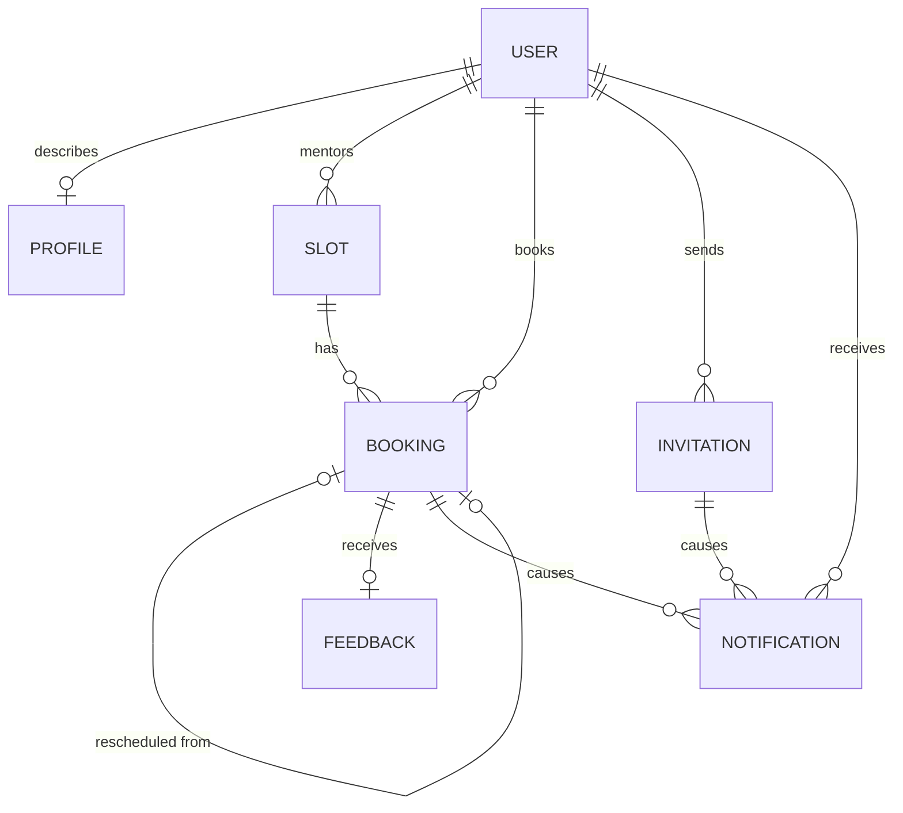
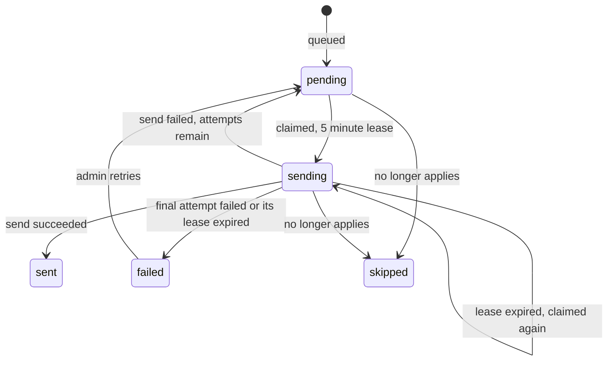

# Architecture

InterviewOps is one Django project with two processes: a web process that serves
the API, and a worker that sends email. PostgreSQL holds the data, enforces
the scheduling constraints and stores the email queue.

It has not been deployed. This document describes what the code does.

## Components

| Path | Responsibility |
|---|---|
| `accounts/` | custom user model with a role, registration, expiring token login and logout, user list, role endpoint |
| `scheduling/views.py` | authentication, permissions, validation and serialisation for slots and bookings |
| `scheduling/services.py` | slot, booking, cancellation and role changes, each in a transaction |
| `scheduling/models.py` | tables, indexes and database constraints |
| `notifications/` | email queue, composing, delivery, worker, delivery records, admin overview |
| `feedback/` | feedback, ratings over time |
| `config/` | settings, URL routing, health and client settings, CORS, error bodies, request logging, pagination, ordering |

Invitations and passwords have their own modules in `accounts/`. Role and status
changes affect scheduling, so they go through `services.change_role` and
`services.set_active`.

The Django admin is served at `/admin/` when `ENABLE_ADMIN` is on, which by
default means only in debug mode. Slots, bookings, notifications and feedback are read-only
there, and the role field cannot be edited, because edits would bypass the
service rules.

## Data model

The API does not delete slots or bookings: a cancelled one stays in its table,
marked by a timestamp (slot) or a status and timestamp (booking).

## Database constraints

| Constraint | Kind | Guarantees |
|---|---|---|
| `slot_ends_after_start` | check | a slot ends after it starts |
| `slot_no_mentor_overlap` | exclusion, active slots only | one mentor's active slots do not overlap |
| `booking_one_active_per_slot` | partial unique index | at most one `booked` row per slot |
| `booking_no_student_overlap` | exclusion, `booked` rows only | one student's active bookings do not overlap |
| `booking_cancel_fields_consistent` | check | cancellation fields are set exactly when the status is `cancelled` |
| `user_role_valid` | check | the role is one of the three values |
| `user_email_ci_unique` | unique index | one account per email address, ignoring case |
| `booking_times_match_slot` | deferred trigger | an active booking has its slot's times |
| `invitation_one_open_per_email` | partial unique index | one open invitation per address |
| `notification_one_reminder_per_person` | partial unique index | one reminder per person per booking |
| `feedback_*_range` | check | ratings are 1 to 5 |

The exclusion constraints compare `tstzrange(starts_at, ends_at)`, which is
half-open, `[start, end)`. Back-to-back sessions are therefore allowed. Combining
equality on a user ID with range overlap needs the `btree_gist` extension, which
the first `scheduling` migration creates.

Booking times are copied from the slot so that a constraint on the booking table
can see them. Triggers on both tables check the copy at commit.

Slot duration (15 minutes to 3 hours) and the future-start rule are checked in
the serializer and again in `publish_slot`, not by database constraints.

## Transactions and locking

| Operation | Locks taken, in order |
|---|---|
| `publish_slot` | mentor user row |
| `book_slot` | student user row, slot row |
| `cancel_booking` | slot row, booking row |
| `cancel_slot` | slot row, active booking rows |
| `change_role` | actor and target user rows, in primary-key order |
| `reschedule_booking` | student row, both slot rows in primary-key order, booking row |
| `set_active` | actor and target rows, affected slots in primary-key order, their bookings |
| `update_session`, `record_attendance`, `save_feedback` | slot row, booking row |

The order is always user, then slot, then booking, and two user rows are taken in
primary-key order. User and slot rows are locked
`FOR NO KEY UPDATE`, which serialises writers without blocking the key-share
locks PostgreSQL takes when another row references them. Booking rows are locked
`FOR UPDATE`.

What each lock is for:

- **Student row:** two requests from one student for different slots would
  otherwise take different slot locks and could deadlock inside the exclusion
  check. See [investigation 001](investigation-001-deadlock.md).
- **Mentor row:** the same reasoning for overlapping slots published at once.
  It also serialises publishing with a role change.
- **Slot row:** orders booking and cancellation, so a live booking cannot be left
  on a cancelled slot.
- **Both users in a role change:** the actor's role is checked again under the
  lock, so two admins demoting each other cannot both succeed.

`book_slot` reads the current time after it holds its locks, so a request that
waited cannot book a slot that started during the wait.

When a constraint rejects a write in `publish_slot` or `book_slot`,
`services.py` maps the three expected constraint names to a `409` response. Any
other integrity error is re-raised.

## Email queue

Every email is a row in `notifications_notification`, written in the same
transaction as the change that causes it. The kinds are listed in
[API.md](API.md#emails).

1. **Claim.** In a short transaction the worker takes the oldest due row with
   `FOR UPDATE SKIP LOCKED`, marks it `sending`, increments `attempts` and sets a
   lease. A notice that no longer applies (cancelled or started booking, inactive
   person, closed invitation) is marked `skipped`.
2. **Deliver.** Outside any transaction. The message is composed now, so it shows
   current details. Links containing secrets are signed at this point; none are
   stored.
3. **Record.** Written only if the attempt still owns the row.

| Setting | Value |
|---|---|
| Reminder lead time | 24 hours |
| Lease | 300 seconds |
| Mail timeout | 20 seconds |
| Maximum attempts | 10 |
| Wait after a failed attempt | 60 seconds, doubling, at most 3600 |
| Worker poll interval when idle | 15 seconds |

Delivery is at-least-once: a worker that dies after the mail server accepts a
message will send it again. A cancellation during a send cannot recall it.

The worker finishes the message in hand on `SIGINT` or `SIGTERM`. With debug off
it refuses the console email backend. `check_queue` fails when mail is waiting too
long.

## Authentication and authorisation

- Token authentication only on the API. One token per user, expiring 12 hours
  after creation; logout deletes it, and login replaces an expired one under a
  lock on the user row. Deactivated users are rejected.
- Sign-up is closed outside debug mode unless `ALLOW_REGISTRATION` is set.
- Browser origins must be listed in `CORS_ALLOWED_ORIGINS`. Only `/api/` and
  `/health/` are shared, without cookies or wildcards.
- Permission classes gate actions by role. Querysets scope what each role can
  read, so another user's booking is `404`.
- The `admin` role is separate from Django's `is_staff`. `createsuperuser` sets
  both. Promoting a user through the API grants the role but not access to
  `/admin/`; moving a user out of the admin role clears `is_staff` and
  `is_superuser`.
- An inactive mentor's slots are hidden from students and cannot be booked.
- Sign-up, login, invitation acceptance and password endpoints share a limit of
  10 requests per minute per address, counted in a database cache table that all
  web processes share. The counter is not atomic, so a burst can exceed it slightly.

## Logging and health

`RequestLogMiddleware` writes one line per request with a request ID, method,
path, status, user ID and duration, and returns the ID in `X-Request-ID`. It does
not log bodies, query strings or authorisation headers. Django's own request
logger adds lines for failed requests, and `runserver` logs the full request
line.

Email retry and failure logs contain the exception type, not its message,
because mail errors can echo addresses. The message is stored in
`Notification.last_error`. The default console email backend prints whole messages,
including the recipient.

`GET /health/` runs `SELECT 1` and returns `200`, or `503` if the query fails. It
does not check the worker or the mail server.

## Configuration

Settings are read from environment variables. Django does not load `.env` files
here.

| Variable | Default | Purpose |
|---|---|---|
| `DATABASE_URL` | `postgresql://interviewops@localhost:5432/interviewops` | database; query parameters such as `sslmode` become connection options |
| `DJANGO_DEBUG` | off | `1`, `true` or `yes` enables debug mode |
| `DJANGO_SECRET_KEY` | none | required unless debug is on |
| `DJANGO_ALLOWED_HOSTS` | `localhost,127.0.0.1` | comma-separated host names |
| `RENDER_EXTERNAL_HOSTNAME` | none | appended to allowed hosts when present |
| `SECURE_SSL_REDIRECT` | on when debug is off | redirect HTTP to HTTPS, except `/health/` |
| `NUM_PROXIES` | `0` | trusted proxy count used to identify clients for throttling |
| `ENABLE_ADMIN` | same as debug | serve the Django admin |
| `AUTH_THROTTLE_RATE` | `10/min` | sign-up and login limit |
| `TOKEN_TTL_HOURS` | `12` | token lifetime from creation |
| `ALLOW_REGISTRATION` | same as debug | open public sign-up |
| `APP_BASE_URL` | `http://localhost:5173` | web app address used in emailed links |
| `CORS_ALLOWED_ORIGINS` | empty | comma-separated browser origins allowed to call the API |
| `EMAIL_BACKEND` | console backend | set to Django's SMTP backend to send mail; the worker requires a non-console backend when debug is off |
| `EMAIL_HOST` | `localhost` | SMTP host |
| `EMAIL_PORT` | `587` | SMTP port |
| `EMAIL_HOST_USER` | empty | SMTP user |
| `EMAIL_HOST_PASSWORD` | empty | SMTP password |
| `EMAIL_USE_TLS` | on | STARTTLS for SMTP |
| `DEFAULT_FROM_EMAIL` | `no-reply@interviewops.invalid` | sender address |
| `LOG_LEVEL` | `INFO` | root log level |

With debug off, session and CSRF cookies are secure, HSTS is set to one hour and
`X-Forwarded-Proto` is trusted, so the app is meant to run behind a proxy that
sets that header.

Business rules (cancellation cutoff, reminder timing, invitation lifetime and
feedback window) are constants in
`config/settings.py`.

## Intended deployment

Not built or deployed. `Dockerfile` produces one image that runs migrations and
then Gunicorn with 2 workers, with static files served by WhiteNoise.
`render.yaml` describes a web service, a mail worker using the same image and
a PostgreSQL database.

## Trade-offs

- **Database queue, not a broker.** One fewer service, and a change and its email
  commit together. Celery with a broker would be worth considering at
  higher volume or with many task types.
- **Locks as well as constraints.** Constraints guarantee correctness. Locks turn
  races into predictable `409` responses instead of deadlocks.
- **Immutable slot times.** A new time is a new slot; students move with
  rescheduling.
